<p align="center">
  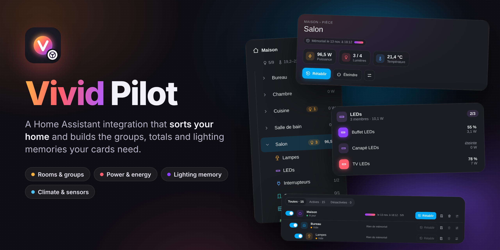
</p>

<p align="center">
  <a href="https://github.com/Florian-BARRE/vivid-pilot/actions/workflows/check.yml"></a>
  <a href="https://github.com/Florian-BARRE/vivid-pilot/actions/workflows/validate.yml"></a>
  <a href="https://github.com/Florian-BARRE/vivid-pilot/releases/latest"></a>
  <a href="https://github.com/Florian-BARRE/vivid-pilot/releases"></a>
  <a href="https://github.com/Florian-BARRE/vivid-pilot/blob/main/LICENSE"></a>
  <br />
  
  
  
  
  <a href="https://github.com/Florian-BARRE/vivid-cards"></a>
</p>

<p align="center">
  <b>Your home, sorted by room and by kind, with the groups, totals and memories built for you.</b><br />
  A Home Assistant integration with its own panel: every detection visible, every one correctable.
</p>

<p align="center">
  <a href="https://my.home-assistant.io/redirect/hacs_repository/?owner=Florian-BARRE&repository=vivid-pilot&category=integration"></a>
  <a href="https://my.home-assistant.io/redirect/config_flow_start/?domain=vivid_pilot"></a>
</p>

<p align="center">
  <a href="#installation">Install</a> ·
  <a href="#whats-inside">What's inside</a> ·
  <a href="https://github.com/Florian-BARRE/vivid-pilot/blob/main/docs/README.md">Documentation</a> ·
  <a href="#vivid-pilot--vivid-cards">With Vivid Cards</a> ·
  <a href="https://github.com/Florian-BARRE/vivid-pilot/blob/main/CHANGELOG.md">Changelog</a>
</p>

<p align="center">
  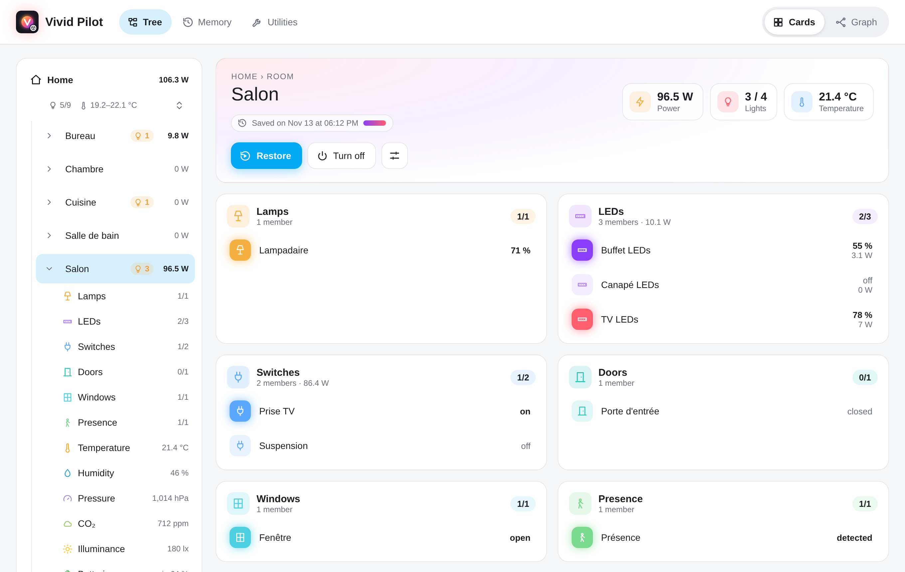
</p>

## Vivid Pilot + Vivid Cards

Vivid Pilot is one half of **Vivid**. It sorts your home; its companion,
[**Vivid Cards**](https://github.com/Florian-BARRE/vivid-cards), shows it on your
dashboards with cards and badges that glow with the state of each room. A card
just picks a room or a group: Vivid Pilot has already worked out the rest. Each
also works on its own.

<p align="center">
  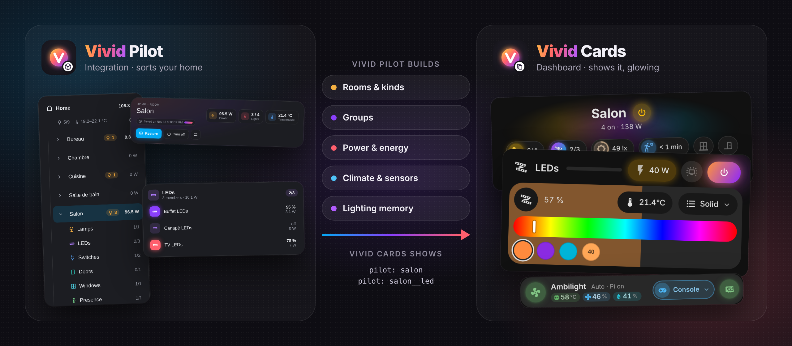
</p>

<table>
  <tr>
    <td width="50%" valign="top">&nbsp;<b>Vivid Pilot</b> · you are here<br />&nbsp;<sub>The integration: rooms, groups, totals, power, memory.</sub></td>
    <td width="50%" valign="top">&nbsp;<a href="https://github.com/Florian-BARRE/vivid-cards"><b>Vivid Cards</b></a><br />&nbsp;<sub>The cards and badges: lights, Ambilight, energy, climate.</sub></td>
  </tr>
</table>

## Why Vivid Pilot

- **It reads your home, not your entity names.** Rooms come from Home Assistant
  areas; what each device is (lamp, LED strip, plug, door, window, presence,
  thermometer, battery, power meter…) comes from its integration, device class
  and features. Nothing to template.
- **Everything a dashboard needs, already computed.** Lamps, LEDs and switches as
  groups per room and for the home; doors, windows and presence as one sensor;
  climate as mean, min and max; the lowest battery; power and energy without
  counting a device twice; WLED power from the estimated current.
- **The last lighting of every room.** Each room remembers how its lights were,
  continuously, and restores it with one tap or one service call. Turning
  everything off never overwrites it.
- **Visible and correctable.** A sidebar panel shows every detection and why it
  was made; change a kind, a room or a power source in two taps.
- **Live.** Add a lamp to an area and it joins the room's group at once, no
  restart.

## What's inside

<table>
  <tr>
    <td width="50%" valign="top"><a href="https://github.com/Florian-BARRE/vivid-pilot/blob/main/docs/concepts/tree.md">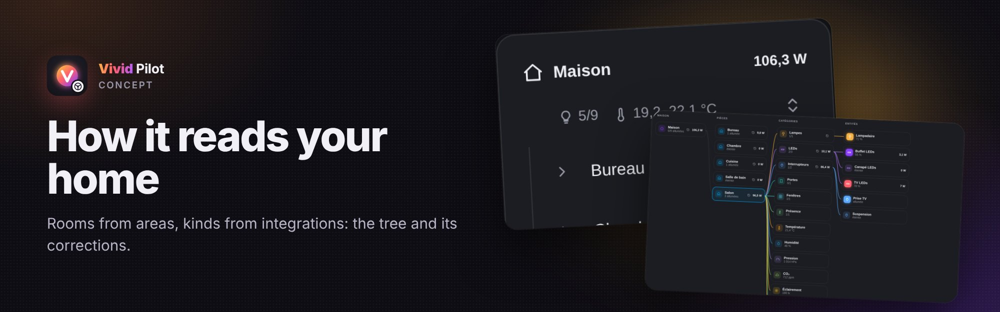</a><br /><b><a href="https://github.com/Florian-BARRE/vivid-pilot/blob/main/docs/concepts/tree.md">How it reads your home</a></b><br /><sub>Rooms from areas, kinds from integrations, and your corrections.</sub></td>
    <td width="50%" valign="top"><a href="https://github.com/Florian-BARRE/vivid-pilot/blob/main/docs/concepts/groups.md">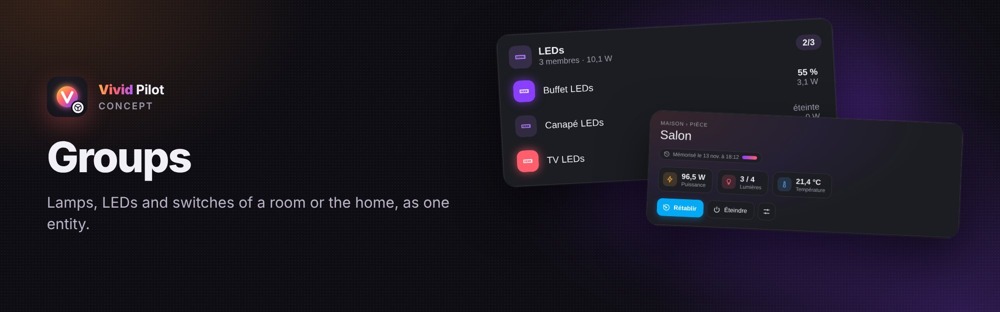</a><br /><b><a href="https://github.com/Florian-BARRE/vivid-pilot/blob/main/docs/concepts/groups.md">Groups</a></b><br /><sub>Lamps, LEDs and switches of a room or the home, colors and effects included.</sub></td>
  </tr>
  <tr>
    <td width="50%" valign="top"><a href="https://github.com/Florian-BARRE/vivid-pilot/blob/main/docs/concepts/measures.md">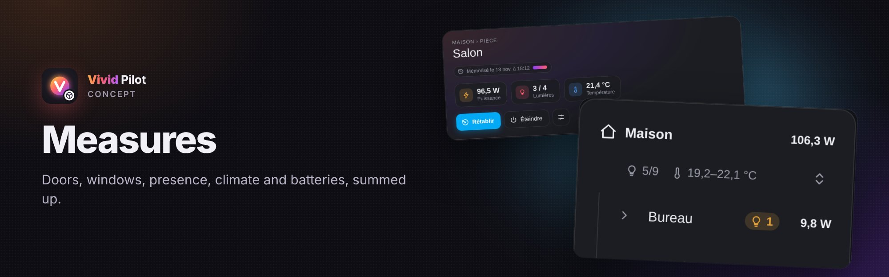</a><br /><b><a href="https://github.com/Florian-BARRE/vivid-pilot/blob/main/docs/concepts/measures.md">Measures</a></b><br /><sub>Openings, presence, climate and batteries, summed up per room.</sub></td>
    <td width="50%" valign="top"><a href="https://github.com/Florian-BARRE/vivid-pilot/blob/main/docs/concepts/power.md">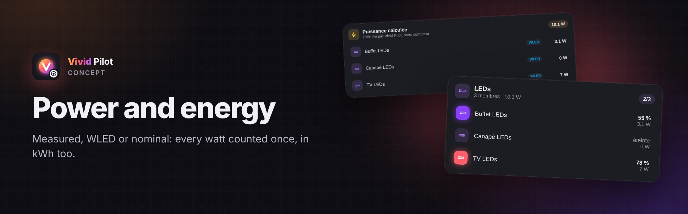</a><br /><b><a href="https://github.com/Florian-BARRE/vivid-pilot/blob/main/docs/concepts/power.md">Power and energy</a></b><br /><sub>Measured, WLED or nominal, each watt counted once, in kWh too.</sub></td>
  </tr>
  <tr>
    <td width="50%" valign="top"><a href="https://github.com/Florian-BARRE/vivid-pilot/blob/main/docs/concepts/memory.md">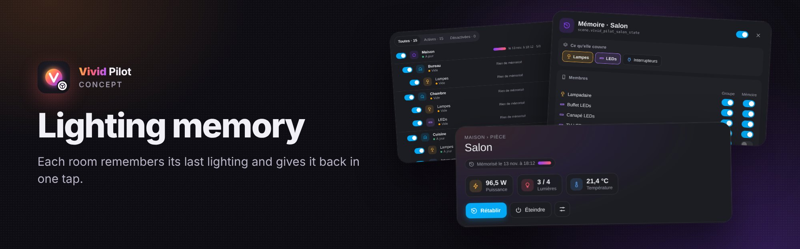</a><br /><b><a href="https://github.com/Florian-BARRE/vivid-pilot/blob/main/docs/concepts/memory.md">Lighting memory</a></b><br /><sub>Each room remembers its last lighting and gives it back in one tap.</sub></td>
    <td width="50%" valign="top"><a href="https://github.com/Florian-BARRE/vivid-pilot/blob/main/docs/guides/panel.md">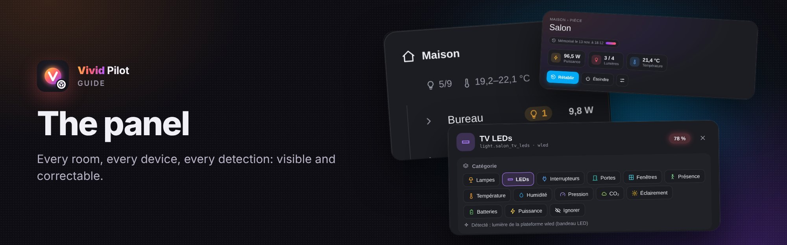</a><br /><b><a href="https://github.com/Florian-BARRE/vivid-pilot/blob/main/docs/guides/panel.md">The panel</a></b><br /><sub>Tree, graph, device sheets, memories and tools, in the sidebar.</sub></td>
  </tr>
</table>

<table>
  <tr>
    <td align="center" valign="top" width="33%">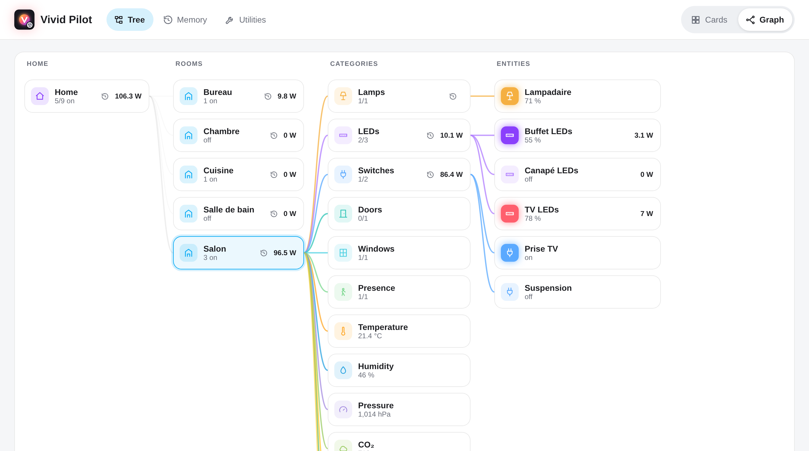<br /><sub><b>Graph</b>: home → rooms → kinds → devices</sub></td>
    <td align="center" valign="top" width="33%">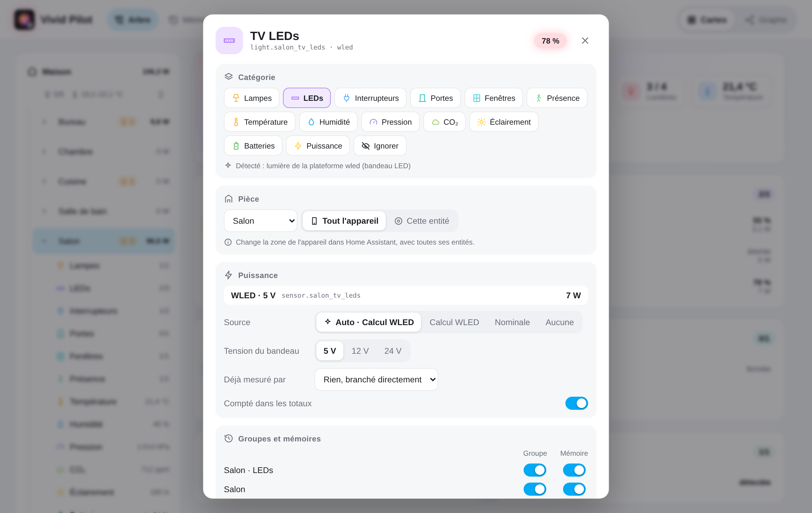<br /><sub><b>A device</b>: kind and why, room, power, groups</sub></td>
    <td align="center" valign="top" width="33%">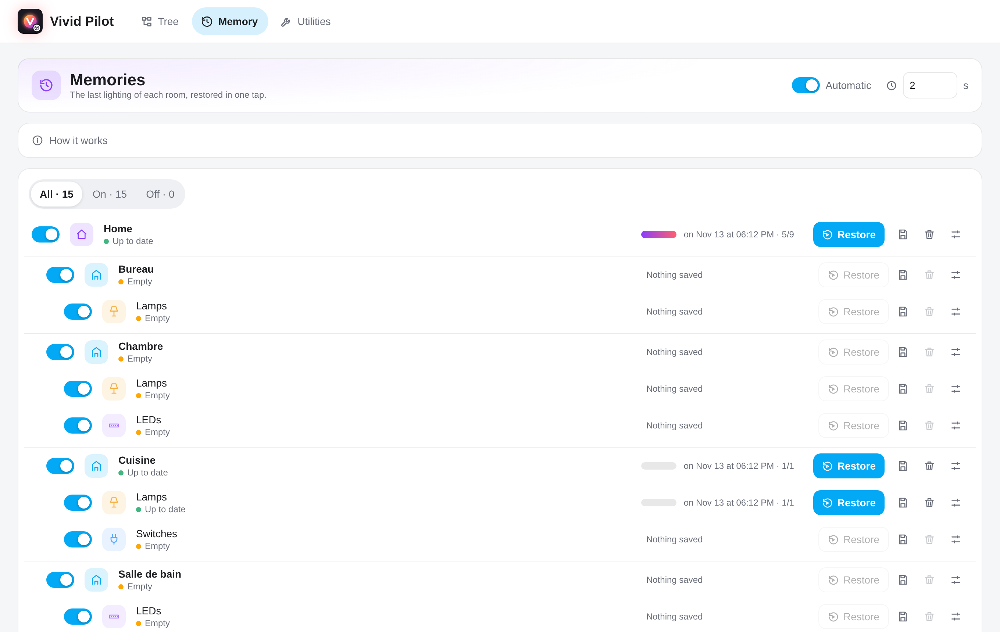<br /><sub><b>Memories</b>: the last lighting of each node</sub></td>
  </tr>
</table>

For the home, each room and each kind of a room, it generates (entity ids start
with `vivid_pilot_` and follow the tree):

| Kind                                   | Entities                                                                     |
| -------------------------------------- | ---------------------------------------------------------------------------- |
| Lamps, LEDs                            | A light group, with the colors, color temperatures and effects of its members |
| Switches                               | A switch group                                                               |
| Doors, windows, presence               | A binary sensor: on when any of them is                                      |
| Temperature, humidity, pressure, CO₂, illuminance | Mean, min and max sensors                                         |
| Batteries                              | The lowest level, with the low batteries listed                              |
| Power                                  | Power (W) and energy (kWh), ready for the Energy dashboard                    |
| Lighting                               | A memory scene with the last lighting                                        |

Every one: [entities and services](https://github.com/Florian-BARRE/vivid-pilot/blob/main/docs/reference/entities.md).

## Installation

**Home Assistant 2026.11 and later: the Marketplace.**

[](https://my.home-assistant.io/redirect/hacs_repository/?owner=Florian-BARRE&repository=vivid-pilot&category=integration)

1. Click the button (or *Settings → Marketplace → ⋮ → Custom repositories*, add
   `https://github.com/Florian-BARRE/vivid-pilot`, type **Integration**).
2. Download **Vivid Pilot**, then restart Home Assistant.
3. Add the integration:

   [](https://my.home-assistant.io/redirect/config_flow_start/?domain=vivid_pilot)

4. Open **Vivid Pilot** in the sidebar (administrators only).

**From 2026.2 to 2026.10: HACS.** The same button opens it in HACS; or HACS → ⋮ →
*Custom repositories* → `https://github.com/Florian-BARRE/vivid-pilot`, type
*Integration*. Then steps 2 to 4.

**Manual.** Download `vivid_pilot.zip` from the
[latest release](https://github.com/Florian-BARRE/vivid-pilot/releases/latest),
unzip it into `config/custom_components/vivid_pilot/`, restart, then steps 3 and 4.

## Quick start

1. **Give every device a room** (its area). The panel's *Unassigned* list shows
   the ones left.
2. **Check the kinds** in the panel: a plug driving a lamp goes to *Lamps*, a
   device to leave out goes to *Ignore*.
3. **Use what is built**: `light.vivid_pilot_salon_led` in a card or an
   automation, `vivid_pilot.restore` with `node: salon`… or add
   [Vivid Cards](https://github.com/Florian-BARRE/vivid-cards) and pick a room.

```yaml
# Back home: every room as it was.
action: vivid_pilot.restore
data:
  node: all
```

## Documentation

**[The documentation](https://github.com/Florian-BARRE/vivid-pilot/blob/main/docs/README.md)**
explains how Vivid Pilot reads your home and what it builds:
[the tree](https://github.com/Florian-BARRE/vivid-pilot/blob/main/docs/concepts/tree.md),
[groups](https://github.com/Florian-BARRE/vivid-pilot/blob/main/docs/concepts/groups.md),
[measures](https://github.com/Florian-BARRE/vivid-pilot/blob/main/docs/concepts/measures.md),
[power and energy](https://github.com/Florian-BARRE/vivid-pilot/blob/main/docs/concepts/power.md),
[lighting memory](https://github.com/Florian-BARRE/vivid-pilot/blob/main/docs/concepts/memory.md),
[entities and services](https://github.com/Florian-BARRE/vivid-pilot/blob/main/docs/reference/entities.md),
[the panel](https://github.com/Florian-BARRE/vivid-pilot/blob/main/docs/guides/panel.md),
[with Vivid Cards](https://github.com/Florian-BARRE/vivid-pilot/blob/main/docs/guides/vivid-cards.md),
[troubleshooting](https://github.com/Florian-BARRE/vivid-pilot/blob/main/docs/guides/troubleshooting.md).

## Contributing

Issues and pull requests are welcome: see [CONTRIBUTING.md](CONTRIBUTING.md), the
[architecture](https://github.com/Florian-BARRE/vivid-pilot/blob/main/docs/architecture.md)
and the conventions in [AGENTS.md](AGENTS.md). The pictures of this page are the
real panel on a demo home ([docs/design](https://github.com/Florian-BARRE/vivid-pilot/blob/main/docs/design/README.md)).

## License

[MIT](LICENSE) © Florian Barre
