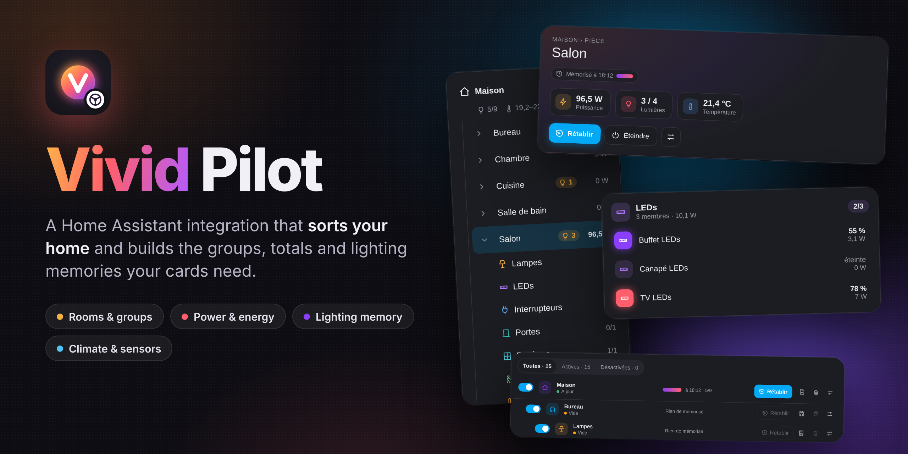
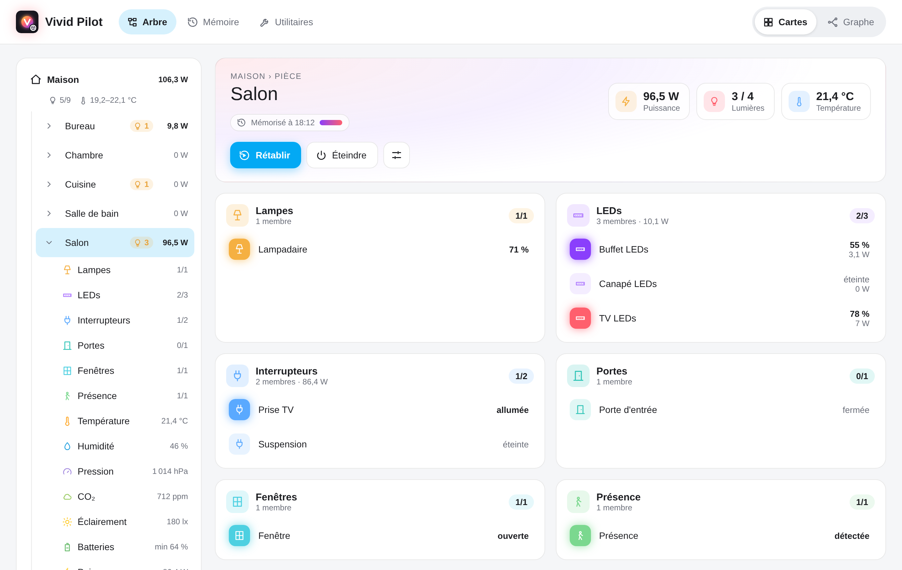
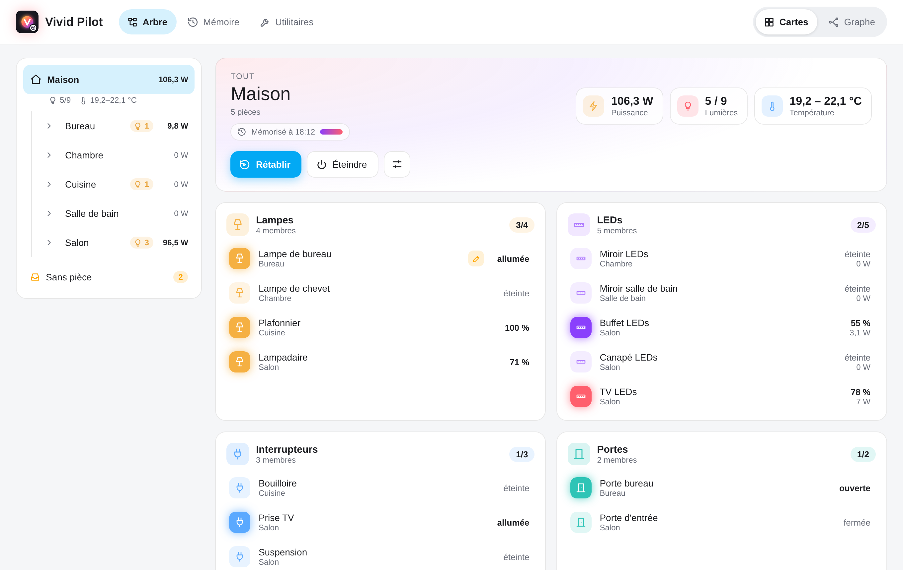
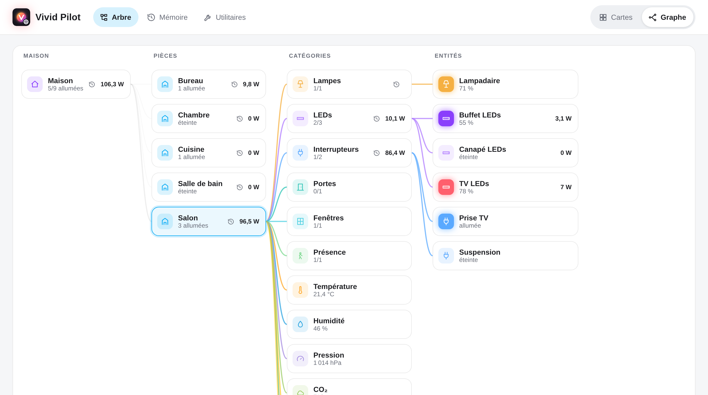
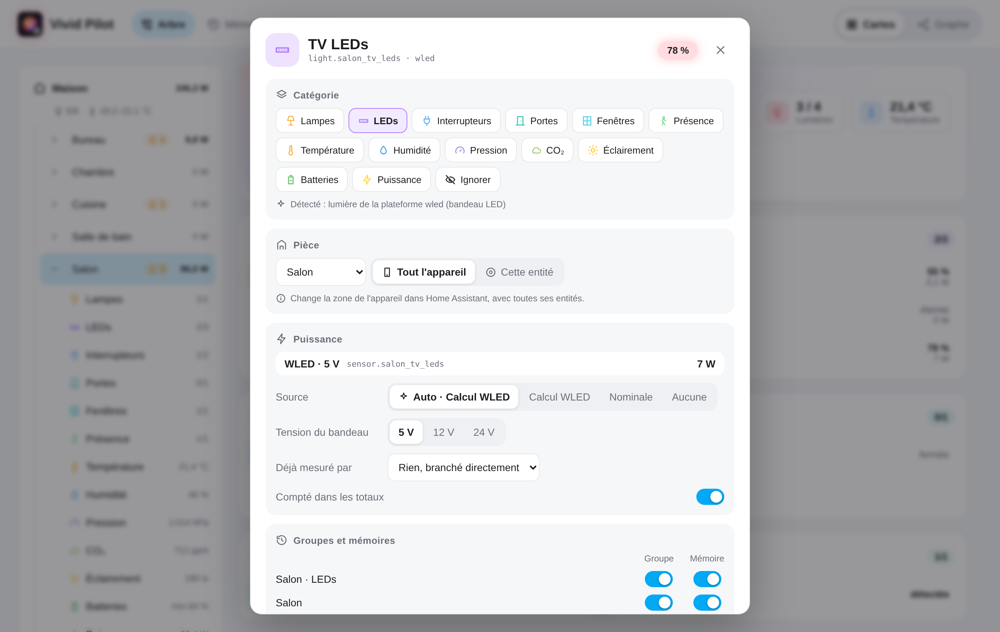
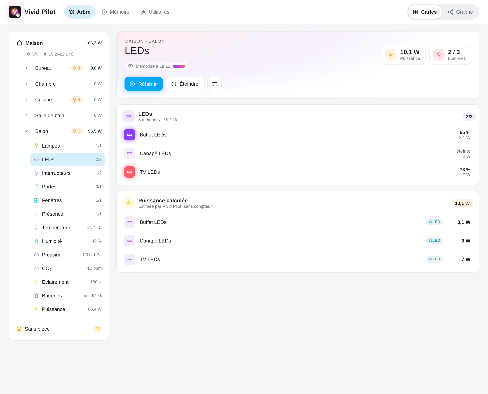
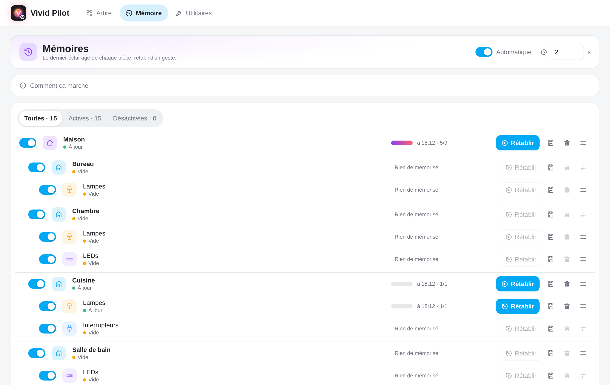
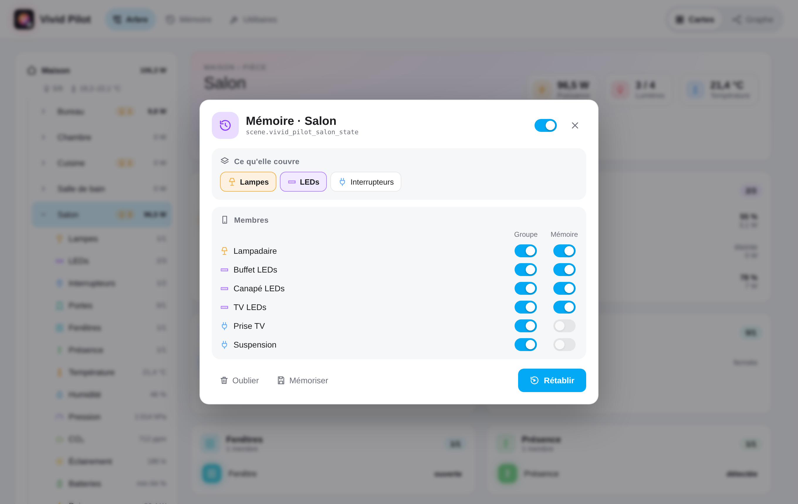
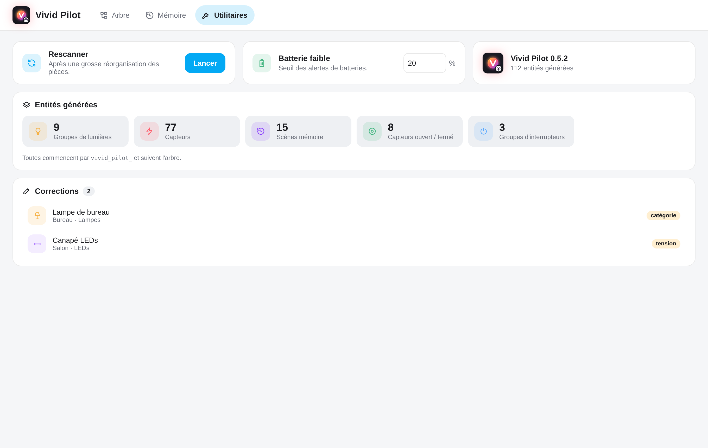
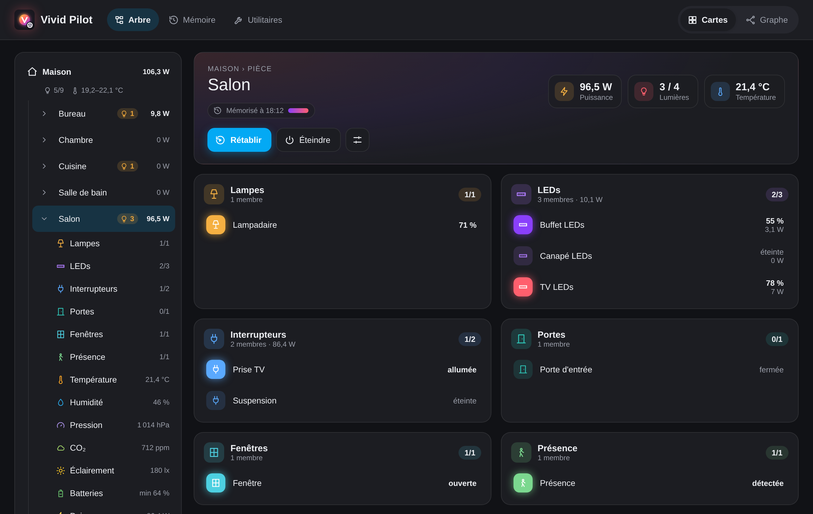

<p align="center">
  
</p>

<p align="center">
  <a href="https://www.home-assistant.io/integrations/marketplace/"></a>
  <a href="https://github.com/Florian-BARRE/vivid-pilot/releases/latest"></a>
  
  <a href="https://github.com/Florian-BARRE/vivid-pilot/blob/main/LICENSE"></a>
</p>

<p align="center">
  <b>Your home, sorted by room and by kind, with the groups, totals and memories built for you.</b><br />
  Every detection is visible and can be corrected from a panel in the sidebar.
</p>

<p align="center">
  <a href="#installation">Install</a> ·
  <a href="#the-panel">Panel</a> ·
  <a href="#what-it-builds">What it builds</a> ·
  <a href="https://github.com/Florian-BARRE/vivid-pilot/blob/main/docs/architecture.md">Architecture</a> ·
  <a href="https://github.com/Florian-BARRE/vivid-pilot/blob/main/CHANGELOG.md">Changelog</a>
</p>

<p align="center">
  
</p>

## Why Vivid Pilot

- **It reads your home, not your entity names.** Rooms come from Home
  Assistant areas; what each device is (lamp, LED strip, plug, door, window,
  presence, thermometer, battery, power meter…) comes from its integration,
  device class and features. Nothing to template.
- **Everything a dashboard needs, already computed.** Lamps, LEDs and switches
  as groups per room and for the home; doors, windows and presence as one
  sensor; climate as mean, min and max; the lowest battery; power and energy
  without counting a device twice; WLED power from the estimated current.
- **The last lighting of every room.** Each room remembers how its lights were,
  continuously, and restores it with one tap or one service call. Turning
  everything off never overwrites it.
- **Visible and correctable.** A sidebar panel shows every detection and why it
  was made; change a category, a room, a power source in two taps.
- **Built for [Vivid Cards](https://github.com/Florian-BARRE/vivid-cards).**
  Every generated entity says which room and kind it belongs to, so a card
  just picks a room or a group. Any other card or automation can use them too.

## The panel

<table>
  <tr>
    <td align="center" valign="top" width="50%"><br /><sub><b>The home</b>: every room, live power, lights on, climate</sub></td>
    <td align="center" valign="top" width="50%"><br /><sub><b>Graph</b>: home → rooms → kinds → devices</sub></td>
  </tr>
  <tr>
    <td align="center" valign="top" width="50%"><br /><sub><b>A device</b>: its kind and why, its room, its power, its groups</sub></td>
    <td align="center" valign="top" width="50%"><br /><sub><b>Power</b>: computed for WLED strips and devices without a meter</sub></td>
  </tr>
  <tr>
    <td align="center" valign="top" width="50%"><br /><sub><b>Memories</b>: the last lighting of each room and kind</sub></td>
    <td align="center" valign="top" width="50%"><br /><sub><b>What a memory covers</b>, device by device</sub></td>
  </tr>
  <tr>
    <td align="center" valign="top" width="50%"><br /><sub><b>Utilities</b>: rescan, battery threshold, what was generated, every correction</sub></td>
    <td align="center" valign="top" width="50%"><br /><sub>Follows your Home Assistant theme, light or dark</sub></td>
  </tr>
</table>

**Rooms and devices.** A device's room is its area in Home Assistant: changing
it in the panel changes it in Home Assistant, for the whole device or for one of
its entities only (a power strip whose plugs sit in different rooms, say).

## What it builds

For the home, each room and each kind of a room (the entity ids start with
`vivid_pilot_` and follow the tree):

| Kind                                   | Entities                                                                   |
| -------------------------------------- | -------------------------------------------------------------------------- |
| Lamps, LEDs                            | A light group, with the colors, color temperatures and effects of its members |
| Switches                               | A switch group                                                             |
| Doors, windows, presence               | A binary sensor: on when any of them is                                    |
| Temperature, humidity, pressure, CO₂, illuminance | Mean, min and max sensors                                       |
| Batteries                              | The lowest level, with the low batteries listed                            |
| Power                                  | Power (W) and energy (kWh), usable in the Energy dashboard                 |
| Lighting                               | A memory scene with the last lighting                                      |

Turning a room's group on with no option restores its memory. The memories are
also reachable as services: `vivid_pilot.save`, `vivid_pilot.restore` and
`vivid_pilot.forget`, each with a `node` (`all`, `salon`, `salon__led`…).

## Installation

**Home Assistant 2026.11 and later (Marketplace).**

1. *Settings → Marketplace → Add*, link `Florian-BARRE/vivid-pilot`.
2. Install **Vivid Pilot**, then restart Home Assistant.
3. *Settings → Devices & services → Add integration → Vivid Pilot*.
4. Open **Vivid Pilot** in the sidebar (administrators only).

**Before 2026.11 (HACS).** HACS → three dots → *Custom repositories* →
`https://github.com/Florian-BARRE/vivid-pilot`, category *Integration*; download
**Vivid Pilot**, restart, then steps 3 and 4.

## Development

See [AGENTS.md](AGENTS.md) for the conventions and
[docs/architecture.md](docs/architecture.md) for the design.

```bash
uv sync                       # Python tools + Home Assistant test harness
uv run pytest                 # tests
uv run ruff check . && uv run ruff format --check .

cd frontend && npm ci
npm run build                 # writes custom_components/vivid_pilot/frontend/vivid-pilot-panel.js
```

The pictures of this page come from the real panel on a demo home: see
[docs/design/README.md](docs/design/README.md).

## License

MIT
