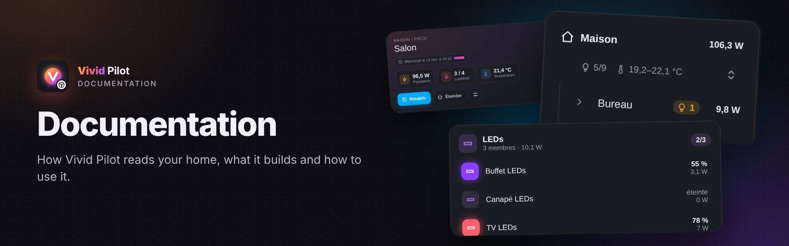
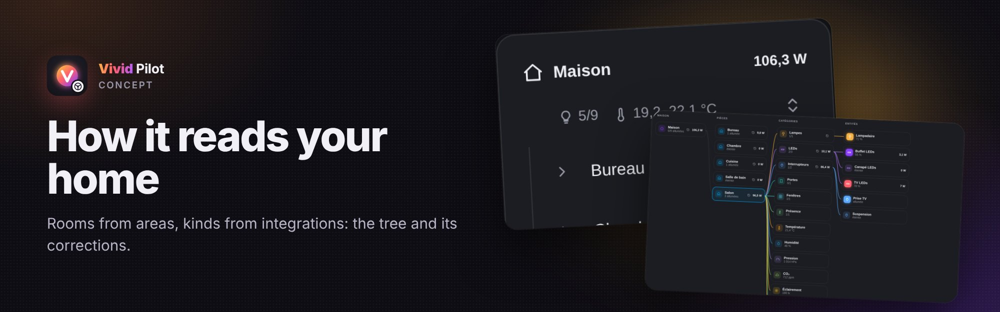
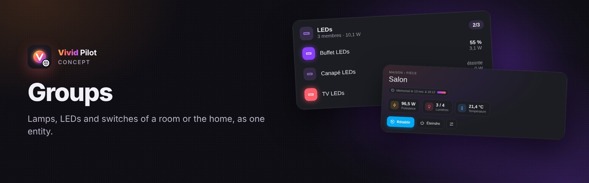
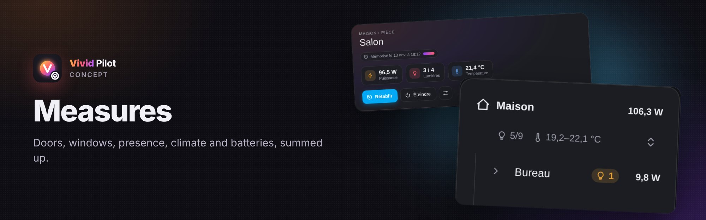
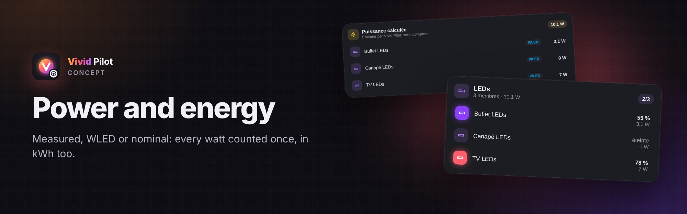
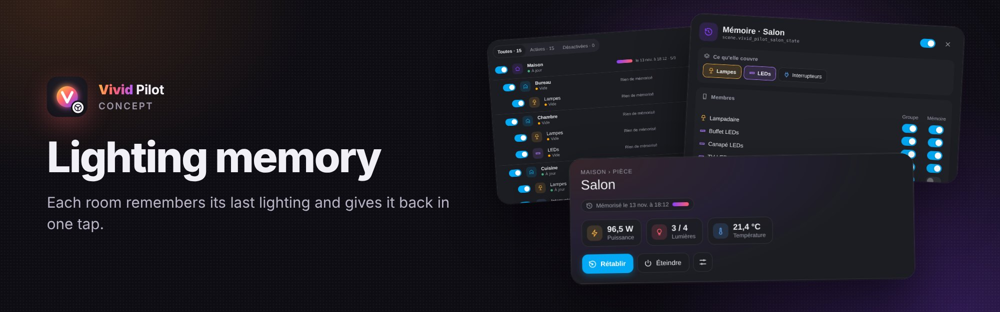
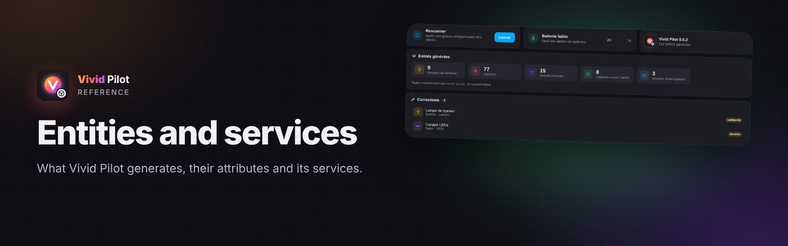

  

<a href="../README.md">Vivid Pilot</a> › Documentation

# Vivid Pilot documentation

Vivid Pilot reads your Home Assistant registries, sorts every device by room and
by kind, and builds what a dashboard needs: groups, totals, power and energy,
the last lighting of each room. This documentation explains how it reads your
home, what it builds, and how to use it, with or without
[Vivid Cards](https://github.com/Florian-BARRE/vivid-cards). New here? Start
with the [installation](../README.md#installation).

## Concepts

<table>
  <tr>
    <td width="50%" valign="top"> <b><a href="concepts/tree.md">How it reads your home</a></b> Rooms from areas, kinds from integrations, and the corrections you make.</td>
    <td width="50%" valign="top"> <b><a href="concepts/groups.md">Groups</a></b> Lamps, LEDs and switches of a room or the home, as one entity.</td>
  </tr>
  <tr>
    <td width="50%" valign="top"> <b><a href="concepts/measures.md">Measures</a></b> Openings, presence, climate and batteries, summed up per room.</td>
    <td width="50%" valign="top"> <b><a href="concepts/power.md">Power and energy</a></b> Measured, WLED or nominal, every watt counted once, in kWh too.</td>
  </tr>
  <tr>
    <td width="50%" valign="top"> <b><a href="concepts/memory.md">Lighting memory</a></b> Each room remembers its last lighting and gives it back in one tap.</td>
    <td width="50%" valign="top"> <b><a href="reference/entities.md">Entities and services</a></b> Every generated entity, its attributes, and the services.</td>
  </tr>
</table>

## Guides

| Page                                         | What it covers                                                         |
| -------------------------------------------- | ---------------------------------------------------------------------- |
| [The panel](guides/panel.md)                 | A tour of the sidebar panel: tree, graph, device sheet, memories, tools |
| [With Vivid Cards](guides/vivid-cards.md)    | Which card shows what, and how a card picks a room or a group          |
| [Troubleshooting](guides/troubleshooting.md) | A device in the wrong room, a power counted twice, an empty memory…    |

## Development

| Page                                   | What it covers                                                     |
| -------------------------------------- | ------------------------------------------------------------------ |
| [Architecture](architecture.md)        | How the integration is built: tree, catalog, power model, memory   |
| [Design sources](design/README.md)     | How the pictures of this documentation are made from the real panel |
| [Contributing](../CONTRIBUTING.md)     | Setup, checks and releases                                         |
