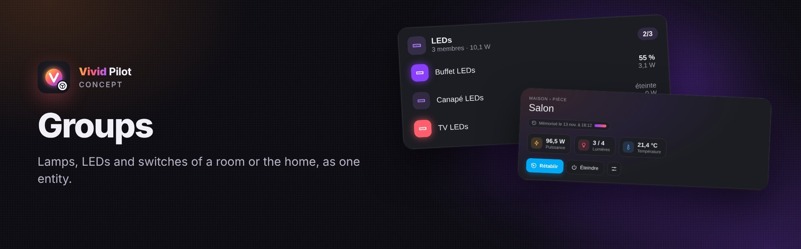
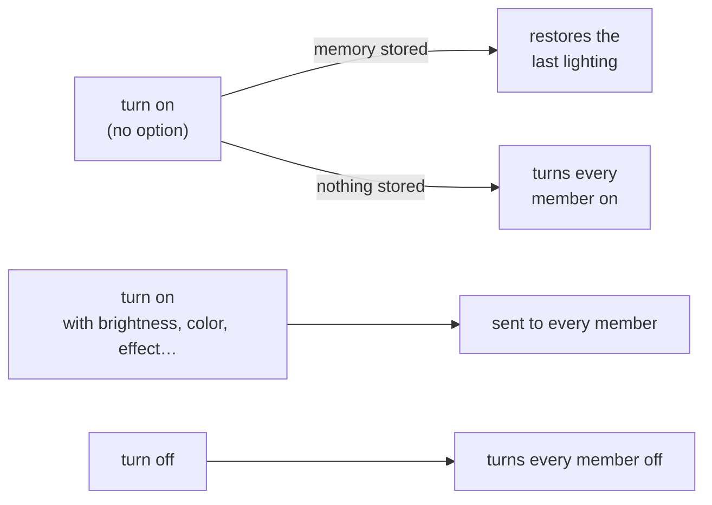

  

<a href="../../README.md">Vivid Pilot</a> › <a href="../README.md">Documentation</a> › Groups

# Groups

For each room, and for the whole home, Vivid Pilot builds **one group per kind
that switches**: lamps, LEDs, switches. A group is a real Home Assistant entity:
turn it on from a card, an automation, a voice assistant or the more-info
dialog.

| Node            | Entity                                  |
| --------------- | --------------------------------------- |
| Salon · lamps   | `light.vivid_pilot_salon_light`         |
| Salon · LEDs    | `light.vivid_pilot_salon_led`           |
| Salon · switches | `switch.vivid_pilot_salon_switch`      |
| Home · lamps    | `light.vivid_pilot_all_light`           |
| Home · LEDs     | `light.vivid_pilot_all_led`             |
| Home · switches | `switch.vivid_pilot_all_switch`         |

There is no combined "lights" group of a room on purpose: lamps and LEDs stay
distinct, so a card can show and drive each.

## What a group does

- **Turn on with no option restores the room's last lighting** when its
  [memory](memory.md) holds one; otherwise every member turns on.
- **Turn on with options** (brightness, color, color temperature, effect,
  transition) behaves like any light group: the options go to every member.
- **Turn off** turns every member off. It never erases the memory.
- **State**: on when any member is on; brightness is the mean of the lit
  members.

Commands always go straight to the real devices and the state is computed from
them, never from another group: no group-of-groups lag.

## Colors and effects

A lamp or LED group offers what its members offer, the way Home Assistant's own
light groups do:

- **color modes**: the union of the members' (RGB, color temperature…);
- **color, color temperature**: the mean of the lit members;
- **effects**: every effect of the members, the current one being the most
  common among the lit members.

So a group of WLED strips shows a color picker and the effect list, in the
more-info dialog as in a card, and a color picked for the group goes to each
strip.

## Who is in a group

Every detected member, minus the ones you exclude. Each node's sheet in the
panel lists its members with two switches: **Group** (what turning the node on
and off commands) and **Memory** (what it restores). They are separate on
purpose: a night light can be switched off with the room without being turned
back on by its memory.

The group lists its members in its `entity_id` attribute, so a card can show
each one.

## See also

- [Lighting memory](memory.md): what turning a group on restores.
- [Power and energy](power.md): the consumption of each group.
- [With Vivid Cards](../guides/vivid-cards.md): the cards that show a group.
