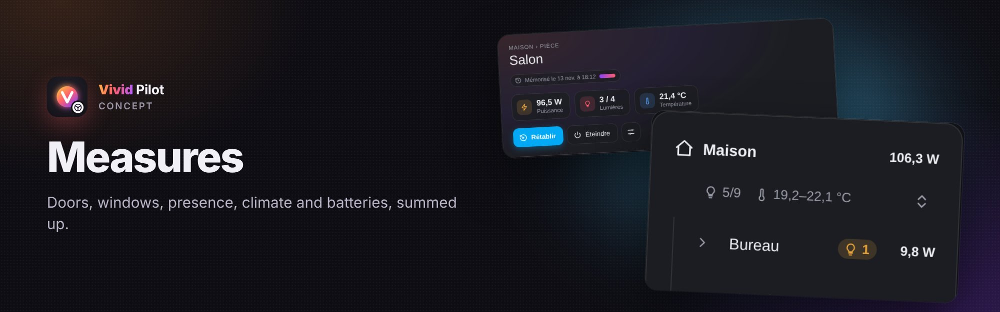
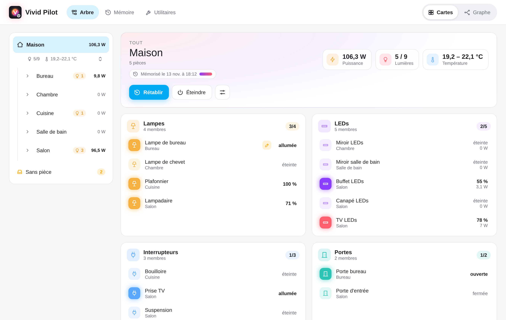

  

<a href="../../README.md">Vivid Pilot</a> › <a href="../README.md">Documentation</a> › Measures

# Measures

The sensors of a room are summed up into a few entities per kind, for the room
and for the whole home. One look tells whether a window is open somewhere, how
warm the flat is, which battery is about to die.

## Openings and presence

| Node               | Entity                                   | State                       |
| ------------------ | ---------------------------------------- | --------------------------- |
| Salon · doors      | `binary_sensor.vivid_pilot_salon_door`     | on when any door is open    |
| Salon · windows    | `binary_sensor.vivid_pilot_salon_window`   | on when any window is open  |
| Salon · presence   | `binary_sensor.vivid_pilot_salon_presence` | on when anyone is detected  |

Attributes: `count_on` (how many are on) and `members_on` (which ones).

## Climate

Temperature, humidity, pressure, CO₂ and illuminance each get **three sensors**:

| Entity                                         | State                         |
| ---------------------------------------------- | ----------------------------- |
| `sensor.vivid_pilot_salon_temperature`         | the mean of the room's sensors |
| `sensor.vivid_pilot_salon_temperature_min`     | the lowest; its attributes name the sensor |
| `sensor.vivid_pilot_salon_temperature_max`     | the highest; same              |

Three sensors and not one with attributes: only a state gets long-term
statistics, history graphs and the 7- and 30-day charts that cards read.
Attributes would be gone after the recorder purge. The minimum and maximum over
time need no entity of their own: the long-term statistics of each sensor keep
the hourly min, mean and max.

## Batteries

`sensor.vivid_pilot_salon_battery` holds **the lowest level** of the room's
batteries (`sensor.vivid_pilot_all_battery` for the home), with:

| Attribute        | Content                                                    |
| ---------------- | ---------------------------------------------------------- |
| `source`         | the battery at the lowest level                            |
| `low`            | the batteries at or below the threshold, lowest first      |
| `low_count`      | how many                                                   |
| `low_threshold`  | the threshold, 20 % by default, set in the Utilities tab   |

## From a room to the home

Every measure goes up one level at a time: kind → room → home. The home's
temperature is the mean over the rooms' sensors, its lowest battery the lowest
of all, its windows open when any room has one open.

  

## See also

- [Power and energy](power.md): the other measure, built differently.
- [Entities and services](../reference/entities.md): every entity and attribute.
