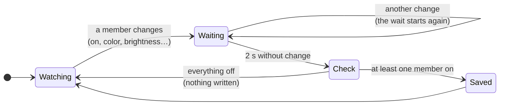
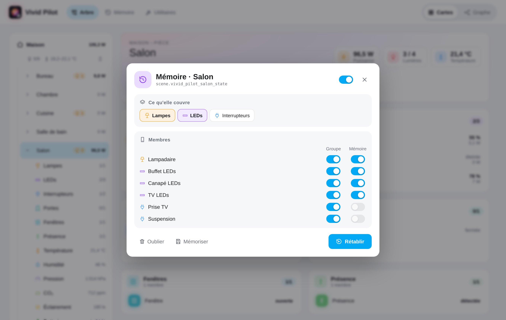
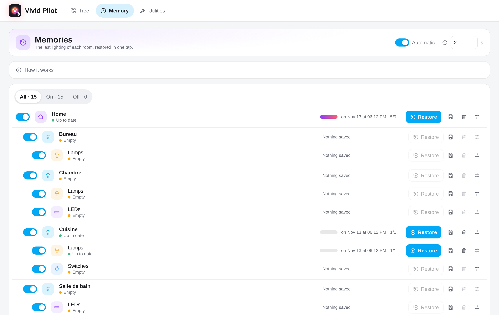

<p align="center">
  
</p>

<sub><a href="../../README.md">Vivid Pilot</a> › <a href="../README.md">Documentation</a> › Lighting memory</sub>

# Lighting memory

**Every room, every kind of light and the whole home remember their last
lighting**, continuously, without a scene to save by hand. Turn the room off at
night, tap it the next evening: the lamps come back at their brightness, the
LEDs in their colors and effects.

## What is remembered

Each node has its own memory, exposed as a scene:

| Node            | Scene                                   | Covers by default          |
| --------------- | --------------------------------------- | -------------------------- |
| Salon           | `scene.vivid_pilot_salon_state`         | the room's lamps and LEDs  |
| Salon · LEDs    | `scene.vivid_pilot_salon_led_state`     | the LEDs                   |
| Salon · lamps   | `scene.vivid_pilot_salon_light_state`   | the lamps                  |
| Home            | `scene.vivid_pilot_all_state`           | every lamp and LED         |

For each light it keeps on or off, brightness, color mode, color, color
temperature and effect. Switches can be added to a memory, and any device taken
out of it, in the node's memory settings.

## When it is saved



- **Automatic**: when a member changes, the memory waits for things to settle
  (2 seconds by default, set in the Memory tab), then saves.
- **Never "all off"**: if everything is off, nothing is written. That is what
  lets *turn on* bring back the last lighting instead of darkness.
- **Each node on its own**: turn the LEDs off while the lamps stay on, and the
  room remembers "lamps on, LEDs off", while the LEDs' own memory keeps their
  last colors.
- Unavailable devices are left out of what is saved.
- Stored by Home Assistant (`.storage/vivid_pilot`): it survives restarts,
  unlike a scene made with `scene.create`.

## How it comes back

| From                          | Does                                                             |
| ----------------------------- | ---------------------------------------------------------------- |
| Turning the node's group on (no option) | restores the memory ([groups](groups.md))                |
| Activating its scene          | restores the memory                                              |
| **Restore** in the panel      | restores the memory                                              |
| `vivid_pilot.restore`         | restores the memory of the node given in `node`                  |
| Vivid Cards' room header      | its power button restores the room's memory, or turns it off     |

Turning on with options (a brightness, a color) is a normal command: the memory
is not involved.

## Settings

<p align="center">
  
</p>

Per node, in its memory settings:

- **On or off**: a memory turned off stops updating and its scene becomes
  unavailable; the group keeps working.
- **What it covers**: lamps and LEDs by default; switches can be added.
- **Members**: each device with two switches, **Group** (what turning the node
  on and off commands) and **Memory** (what it restores).
- **Memorise now**, **Forget**, **Restore**.

In the Memory tab: automatic memorising on or off for the whole home, and the
wait before saving.

<p align="center">
  
</p>

## Services

| Service                | Does                                    |
| ---------------------- | --------------------------------------- |
| `vivid_pilot.save`     | saves the node now (if something is on) |
| `vivid_pilot.restore`  | restores the node's memory              |
| `vivid_pilot.forget`   | erases it                               |

Each takes a `node`: `all`, a room (`salon`), or a kind of a room
(`salon__led`, `salon__light`, `salon__switch`).

```yaml
action: vivid_pilot.restore
data:
  node: salon__led
```

## See also

- [Groups](groups.md): turning a group on restores its memory.
- [Troubleshooting](../guides/troubleshooting.md#a-memory-stays-empty): a memory that stays empty.
