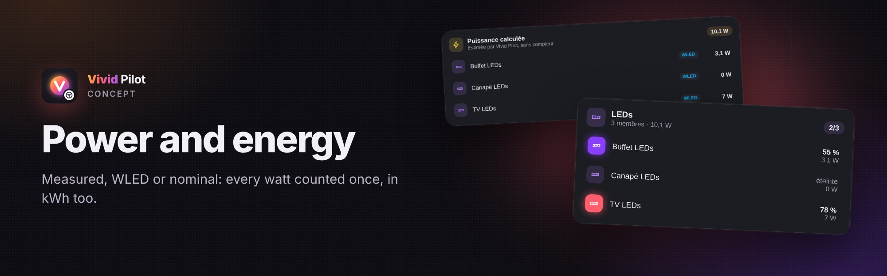
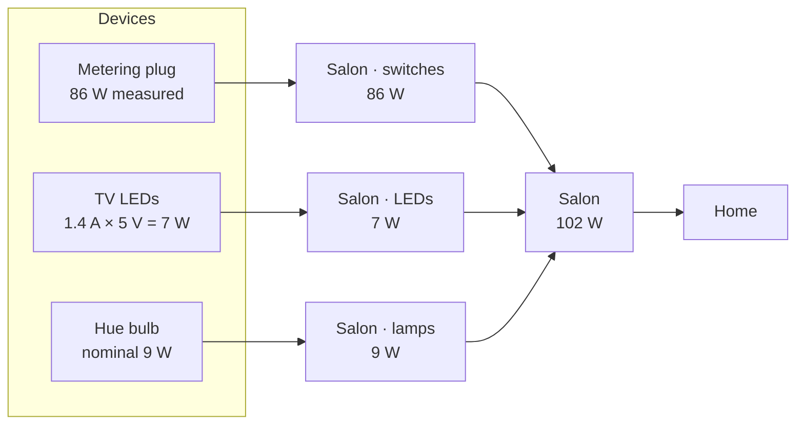
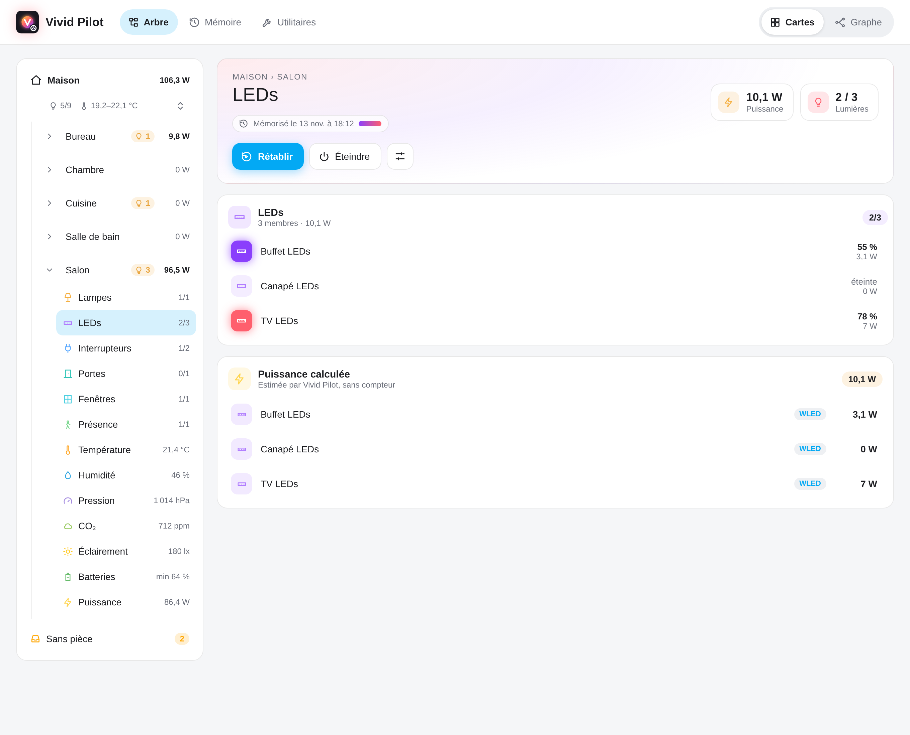

  

<a href="../../README.md">Vivid Pilot</a> › <a href="../README.md">Documentation</a> › Power and energy

# Power and energy

Every lamp, LED strip and switch gets **one power source**, and the watts add up
from the devices to the kind, the room and the home, **each watt counted once**.
Next to every power sensor, an energy sensor in kWh is ready for the Energy
dashboard and the bill cards.

## Where the watts come from

| Source        | How                                                                                  |
| ------------- | ------------------------------------------------------------------------------------ |
| **Measured**  | A power sensor of the device itself (a metering plug, a smart bulb that reports it)   |
| **WLED**      | The strip's estimated current × its voltage (5 V by default, 12 or 24 V per strip)    |
| **Nominal**   | A power you set for a device that reports nothing (a Hue bulb), counted while it is on |
| **None**      | Left out                                                                             |

**Auto** (the default) takes the first that exists: measured, then WLED, then
nominal. The device sheet shows every source with its live value, and lets you
pick another. The WLED estimate depends on the current limiter set in WLED: it
is an estimate, close enough for a total.

## No double counting

A strip powered through a metering plug would count twice: once through the
plug, once through its own estimate. Each source can say **already measured
by…** that plug: it keeps its own sensor, but leaves the totals. Each source can
also be taken out of the totals with **Counted in the totals**.

## Energy

Every power sensor has an energy sensor beside it (`…_energy`, kWh,
`total_increasing`): the power holds between two changes, so each step adds the
previous watts × the time elapsed, closed at least every minute. The total
survives restarts. Add `sensor.vivid_pilot_all_energy` (or a room's) to the
Energy dashboard as an individual device, or let the Vivid Cards electricity
cards read it.

## The entities

| Entity                                       | What                                         |
| -------------------------------------------- | -------------------------------------------- |
| `sensor.vivid_pilot_<strip>_power`           | Power of one WLED strip                       |
| `sensor.vivid_pilot_salon_led_power` / `_energy` | One kind of a room                        |
| `sensor.vivid_pilot_salon_power` / `_energy` | The room                                     |
| `sensor.vivid_pilot_all_power` / `_energy`   | The home                                     |

The panel shows, under each kind, the power it computes itself (WLED strips,
nominal powers):

  

## See also

- [Groups](groups.md): the kinds the power adds up by.
- [Troubleshooting](../guides/troubleshooting.md#a-power-is-counted-twice): a total too high.
