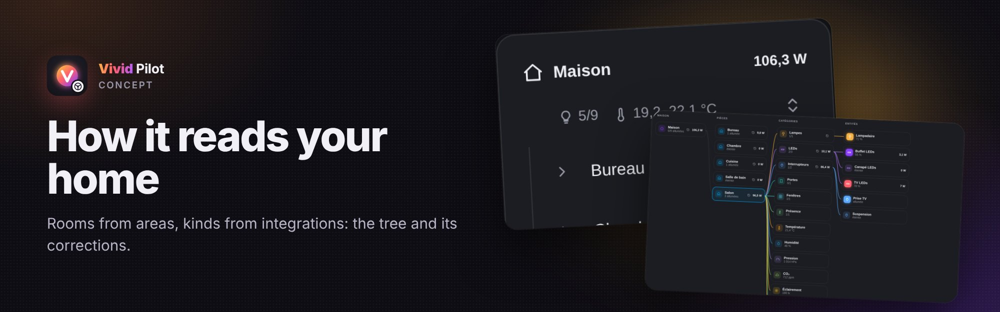
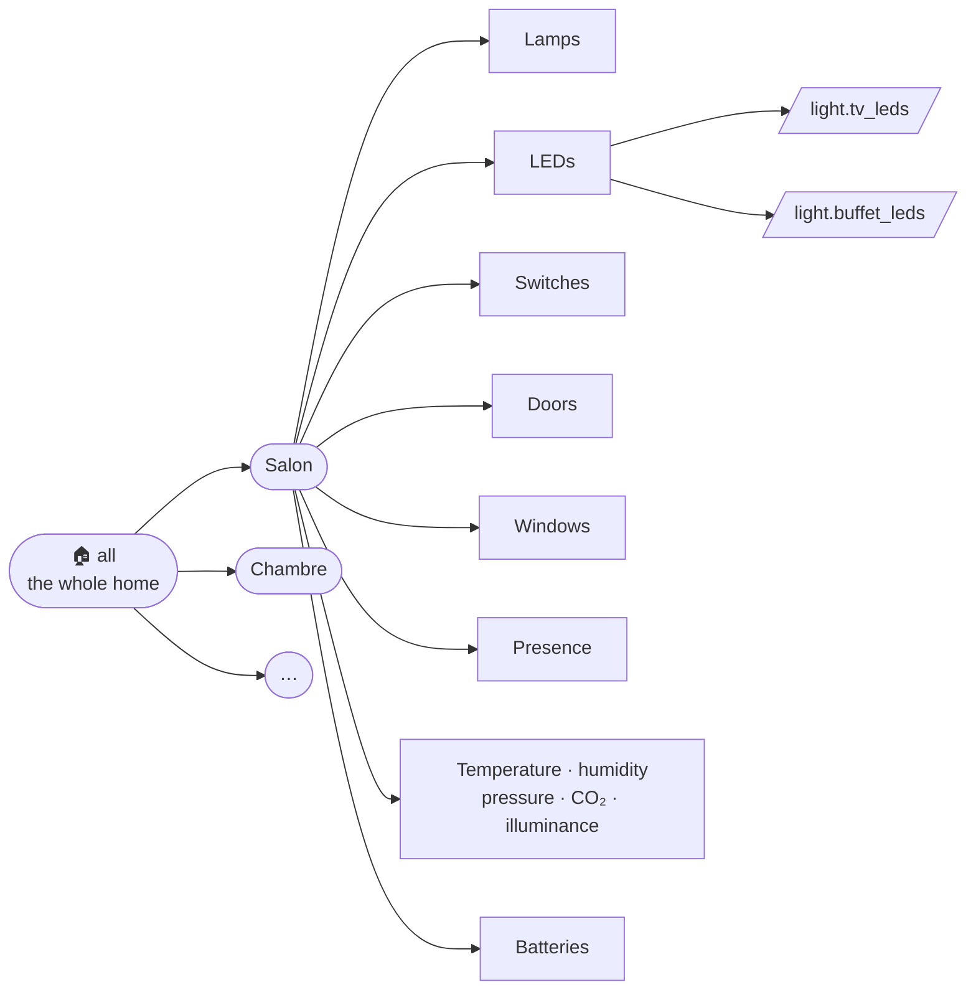
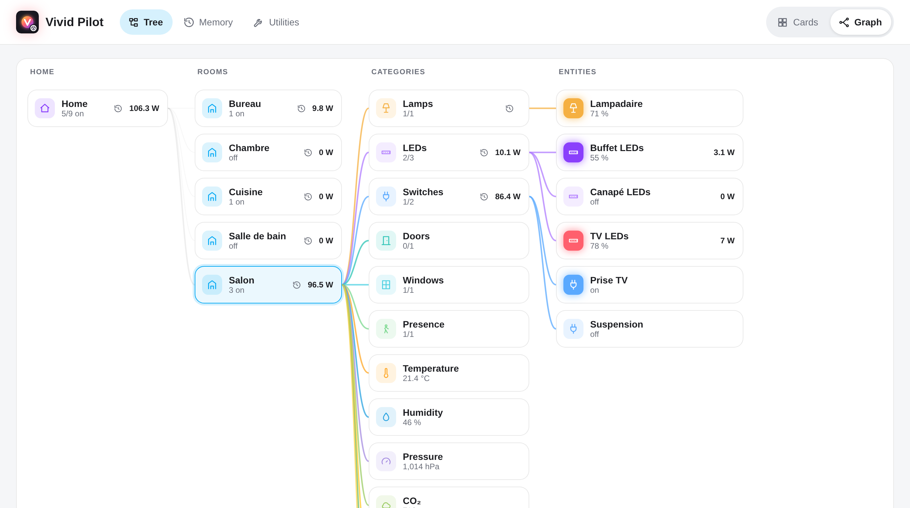
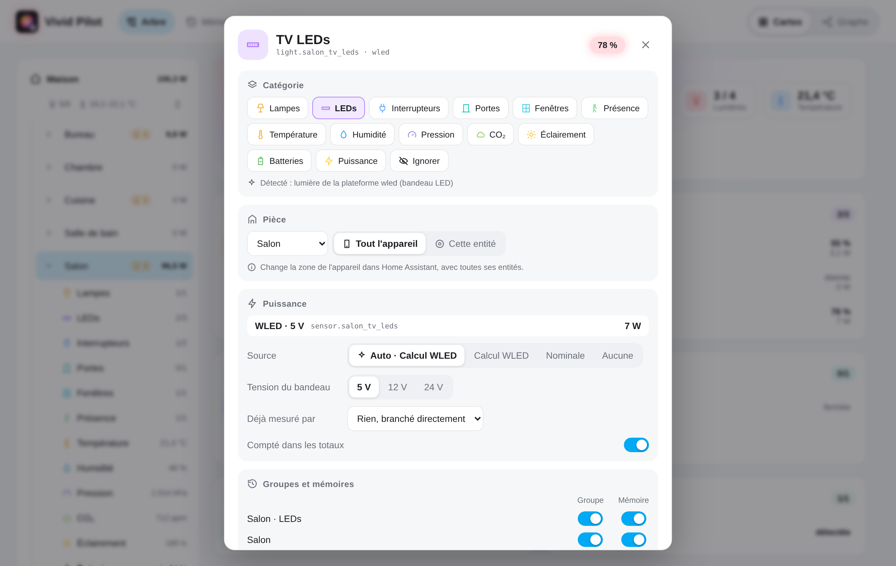

  

<a href="../../README.md">Vivid Pilot</a> › <a href="../README.md">Documentation</a> › How it reads your home

# How it reads your home

Vivid Pilot never guesses from names. It reads the Home Assistant registries:
**a device's room is its area**, and **what a device is comes from its
integration, its device class and its features**. From that, it builds one tree
that everything else hangs on: groups, totals, memories.

## The tree

- **`all`** is the whole home, then **one node per area** (a room), then **one
  node per kind** inside it.
- **The leaves are your real entities**; every other node is generated by Vivid
  Pilot. A node exists only while it has members: an empty kind disappears.
- **Live**: add a lamp to the *Salon* area and it joins the Salon's lamps at
  once, without a restart. Entity, device and area changes all rebuild the tree.

The panel shows this tree as a list ([the panel](../guides/panel.md)) and as a
graph:

  

## Rooms come from areas

An entity belongs to the area of its device, unless the entity has an area of
its own: then that one wins. A device with no area lands in **Unassigned**, a
list of its own in the panel, until you give it a room.

Changing a device's room in the panel **changes its area in Home Assistant**:
there is one source of truth, the area. You choose what moves:

| Choice          | What changes                                                                 |
| --------------- | ---------------------------------------------------------------------------- |
| **Whole device** | The device's area: every entity of the device follows. The usual case.      |
| **This entity**  | Only this entity's own area. For a device spread over rooms: a power strip whose plugs sit in different rooms, a box whose pressure sensor you want out of the living room's measures. |

## Kinds come from the registries

| Kind              | Detected from                                                                                   |
| ----------------- | ----------------------------------------------------------------------------------------------- |
| Lamps             | `light` entities, except LED strips                                                             |
| LEDs              | `light` entities of the `wled` integration                                                      |
| Switches          | `switch` entities (plugs included)                                                              |
| Doors · windows   | `binary_sensor` of class `door` / `garage_door` / `window`; a generic `opening` counts as a window |
| Presence          | `binary_sensor` of class `motion` / `occupancy` / `presence`                                    |
| Climate           | `sensor` of class `temperature`, `humidity`, `atmospheric_pressure` / `pressure`, `carbon_dioxide`, `illuminance` |
| Batteries         | `sensor` of class `battery`, the diagnostic ones too (integrations file them so)                 |
| Power             | `sensor` of class `power`, plus the power computed for WLED strips                               |

**Never candidates**: disabled entities, entities hidden by an integration (the
switch behind a *switch as light*), configuration and diagnostic entities
(battery levels excepted), `group` entities, and Vivid Pilot's own entities.

Lamps and LEDs are siblings, never one inside the other: a room has a lamp group
and an LED group, and a card can show both.

## Corrections always win

Every detection shows its reason in the device sheet ("light of the wled
platform (LED strip)"), and every one can be changed:

- **Kind**: a smart plug that drives a lamp moves from *Switches* to *Lamps*,
  and from then on it is counted, grouped and remembered as a lamp.
- **Ignore**: a device you never want in a group, a total or a memory.
- **Room**: see above.

Corrections are stored, survive restarts and rescans, and show with a small
pencil in the panel. **Back to detection** (per kind) and **Reset everything to
auto** (per device) undo them. The Utilities tab lists every correction.

  

## See also

- [Groups](groups.md): what is built from the lamps, LEDs and switches.
- [Measures](measures.md): what is built from the sensors.
- [Entities and services](../reference/entities.md): every generated entity.
