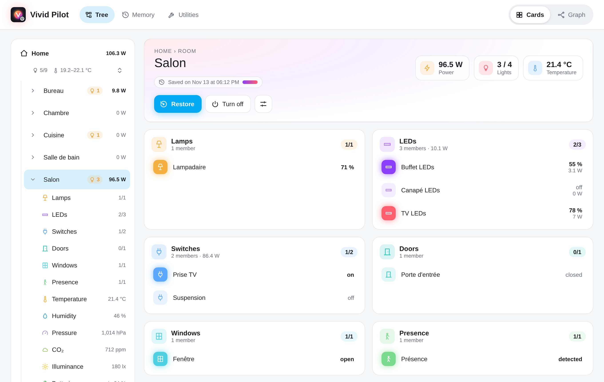
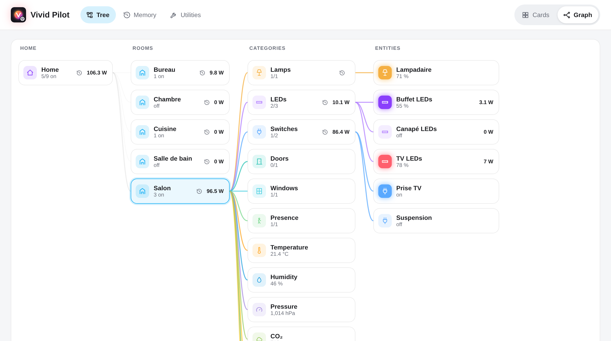
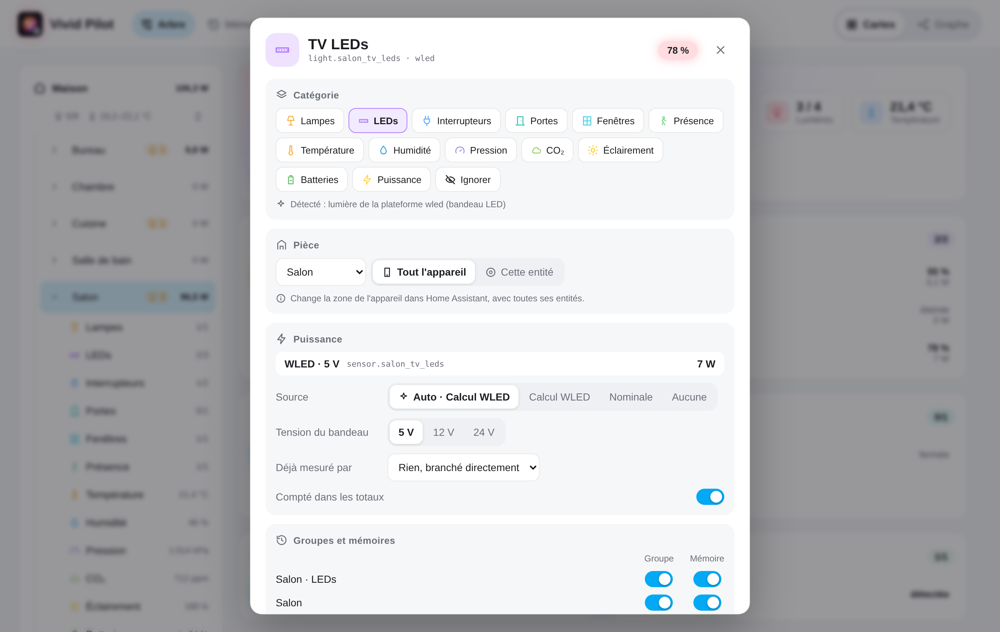
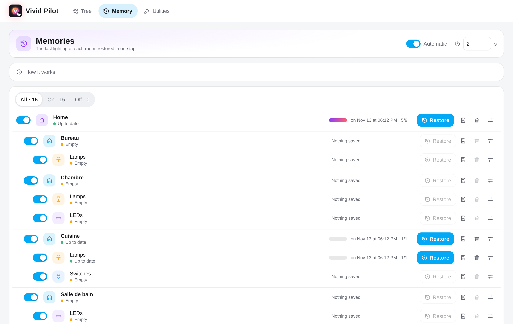
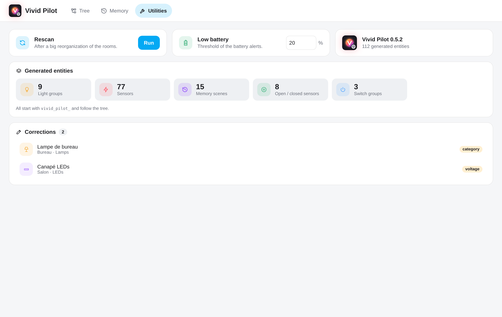

  

<a href="../../README.md">Vivid Pilot</a> › <a href="../README.md">Documentation</a> › The panel

# The panel

**Vivid Pilot** in the sidebar (administrators only) shows everything the
integration has read and built, live, and is where you correct it. It follows
your Home Assistant theme, light or dark, and works on a phone.

Three tabs: **Tree**, **Memory**, **Utilities**.

## Tree

  

- **On the left**, the tree: the home, then each room with its lights on and its
  power. Unfold a room for its kinds; the button under *Home* folds or unfolds
  them all. *Unassigned* lists the devices without an area, *Ignored* the ones
  set aside.
- **On the right**, the selected node: its power, lights on and temperature, its
  memory ("Memorised at 18:03"), **Restore** / **Turn off** and its memory
  settings, then one card per kind with each device.
- A device's icon lights up in its color when it is on; a pencil marks a
  correction made by hand.
- **Cards / Graph** (top right) switches to the whole tree as a graph:

  

## A device

Tap a device for its sheet:

  

| Block              | What you set                                                                                 |
| ------------------ | -------------------------------------------------------------------------------------------- |
| Kind               | Its kind, with the reason of the detection; **Ignore**; **Back to detection**                 |
| Room               | Its area in Home Assistant, for the whole device or this entity only                          |
| Power              | Its sources and their values; the source used (auto, measured, WLED, nominal, none); strip voltage; nominal power; **Already measured by**; **Counted in the totals** |
| Groups and memories | For each node above it: in its group, in its memory                                          |

**Reset everything to auto** undoes every correction of the device. Details:
[how it reads your home](../concepts/tree.md), [power](../concepts/power.md).

## Memory

  

Every memory with its last lighting (colors, time, how many lights): switch it on
or off, **Restore**, **Memorise now**, **Forget**, open its settings. On top:
automatic memorising and the wait before saving. Details:
[lighting memory](../concepts/memory.md).

## Utilities

  

**Rescan** after a big reorganisation (the tree follows the registries anyway),
the **low battery** threshold, what was generated by type, and **every
correction** made by hand, one tap away from its device.

## See also

- [Entities and services](../reference/entities.md): what the panel builds.
- [Troubleshooting](troubleshooting.md).
