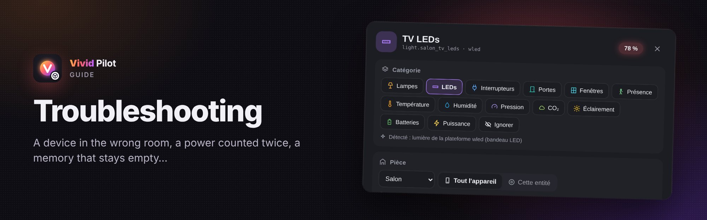

<p align="center">
  
</p>

<sub><a href="../../README.md">Vivid Pilot</a> › <a href="../README.md">Documentation</a> › Troubleshooting</sub>

# Troubleshooting

## A device is in the wrong room

Its room is its area in Home Assistant. Open its sheet in the panel and pick the
room: **Whole device** moves the device, **This entity** moves only this entity
(a device spread over several rooms). See [rooms](../concepts/tree.md#rooms-come-from-areas).

## A device has the wrong kind

A plug that drives a lamp shows under *Switches*: open its sheet and choose
**Lamps**. The reason of the detection is written under the kinds. To leave a
device out of every group, total and memory, choose **Ignore**.

## A device does not show up at all

- Is it disabled, or hidden by an integration (the switch behind a *switch as
  light*)? Those are never candidates.
- Is it a configuration or diagnostic entity? Only battery levels are taken
  among those.
- Has it no area? It is under **Unassigned**: give it a room.

## A power is counted twice

A strip powered through a metering plug counts in both. In the strip's sheet,
set **Already measured by** to the plug: the strip keeps its own sensor but
leaves the totals. Or untick **Counted in the totals**. See
[no double counting](../concepts/power.md#no-double-counting).

## A WLED strip shows a power far from reality

The estimate is the current WLED computes × the voltage. Set the strip's voltage
(5, 12 or 24 V) in its sheet, and check WLED's current limiter (LED
preferences): the estimate follows it.

## A memory stays empty

- Nothing is saved while everything is off: turn a light of the node on, wait 2
  seconds, or use **Memorise now**.
- Is the memory turned on (Memory tab), and automatic memorising too?
- Does the memory cover the kind? A room's memory covers lamps and LEDs by
  default, not switches.

## Turning a room on lights everything, switches included

Turning on restores the memory, which covers lamps and LEDs by default. If
switches come on, they were added to the memory or the group: check the node's
memory settings (the **Group** and **Memory** switches of each member).

## The panel shows nothing new after an update

Restart Home Assistant after updating the integration, then reload the page
(Ctrl+F5, or close and reopen the app).

## Still stuck

Open an [issue](https://github.com/Florian-BARRE/vivid-pilot/issues) with the
version (Utilities tab) and, if you can, the debug log:

```yaml
logger:
  logs:
    custom_components.vivid_pilot: debug
```
