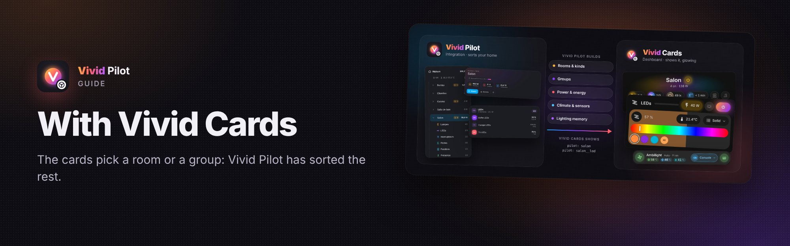
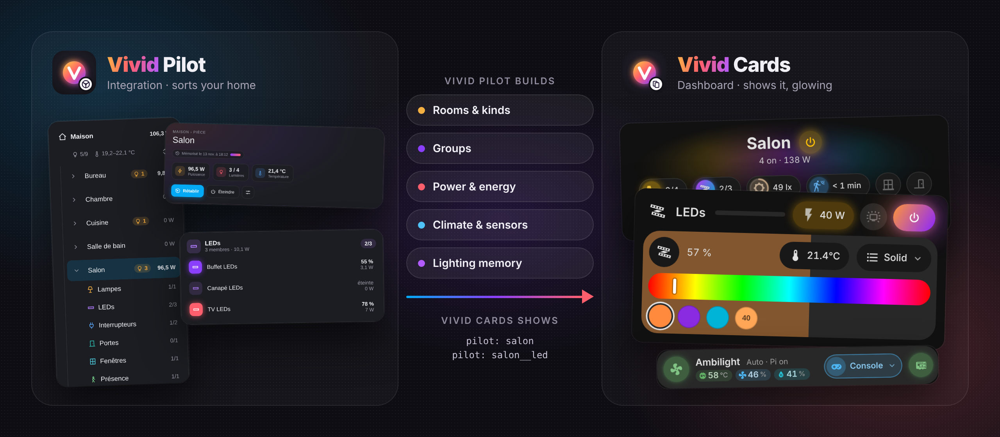

<p align="center">
  
</p>

<sub><a href="../../README.md">Vivid Pilot</a> › <a href="../README.md">Documentation</a> › With Vivid Cards</sub>

# With Vivid Cards

[Vivid Cards](https://github.com/Florian-BARRE/vivid-cards) is the dashboard side
of Vivid Pilot: Lovelace cards and badges that glow with the state of your home.
**Vivid Pilot sorts the home, Vivid Cards shows it**: a card picks a room or a
group, and Vivid Pilot has already worked out the rest.

<p align="center">
  
</p>

## How a card finds its entities

Every card editor starts with **Source**: **Vivid Pilot** or **Manual**. With
Vivid Pilot, the card offers the rooms and groups of the tree, and reads the
entities through their `vivid_pilot_node` and `vivid_pilot_kind` attributes
([entities](../reference/entities.md#attributes)), never their names. With
Manual, you pick everything yourself; both share the same settings.

```yaml
type: custom:vivid-room-header
pilot: salon          # a room, or "all" for the home
```

```yaml
type: custom:vivid-led-group
pilot: salon__led     # the LEDs of the Salon
```

## Which card shows what

| Vivid Pilot builds                     | Shown by                                                                                                  |
| -------------------------------------- | --------------------------------------------------------------------------------------------------------- |
| A room: lights, power, openings, climate, memory | [Room header](https://github.com/Florian-BARRE/vivid-cards/blob/main/docs/cards/room-header.md): title, power button that restores the room's memory, badges |
| LED groups and strip power             | [LED group](https://github.com/Florian-BARRE/vivid-cards/blob/main/docs/cards/led-group.md)                 |
| Lamp groups and their power            | [Lamp group](https://github.com/Florian-BARRE/vivid-cards/blob/main/docs/cards/lamp-group.md)               |
| Openings, presence, batteries, power   | [Status badges](https://github.com/Florian-BARRE/vivid-cards/blob/main/docs/badges/status-badges.md)        |
| Climate                                | [Climate badges](https://github.com/Florian-BARRE/vivid-cards/blob/main/docs/badges/climate-badges.md), [climate card](https://github.com/Florian-BARRE/vivid-cards/blob/main/docs/cards/climate.md) |
| Energy per room                        | [Electricity cards](https://github.com/Florian-BARRE/vivid-cards/blob/main/docs/guides/electricity.md)      |

## Without Vivid Cards

Vivid Pilot does not need Vivid Cards: its entities are regular Home Assistant
entities, usable by any card, automation or voice assistant. And Vivid Cards
works without Vivid Pilot, in manual mode. Together, a dashboard takes a few
taps.

## See also

- [Vivid Cards documentation](https://github.com/Florian-BARRE/vivid-cards/blob/main/docs/README.md)
- [Vivid Pilot and manual](https://github.com/Florian-BARRE/vivid-cards/blob/main/docs/guides/discovery.md), on the cards' side.
